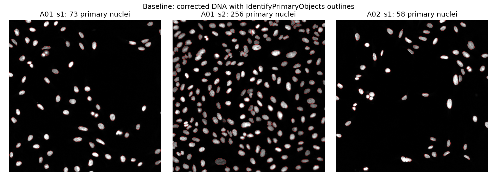
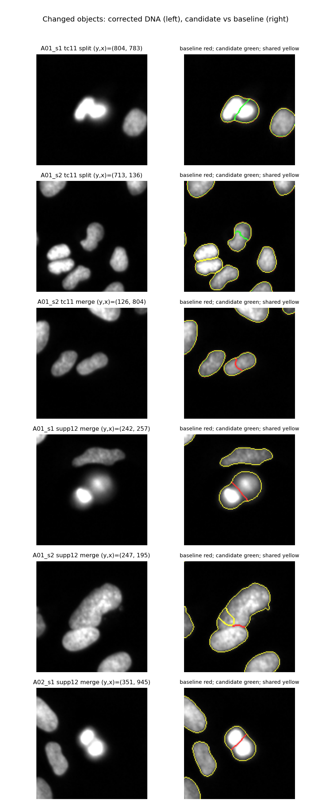
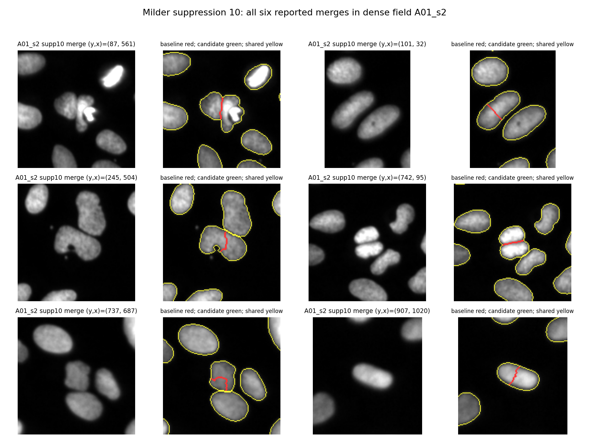

# Three fields, one shared decision

A Codex coding agent compared three IdentifyPrimaryObjects changes across three public Cell Painting fields in one persistent CellProfiler process.
It inspected the changed objects, revised an unsuccessful idea, and kept the baseline pending expert review.
The point of this demonstration is to make a shared setting decision inspectable, not to equate a lower object count with better segmentation.

This is a recorded coding-agent session plus a deterministic replay of its actions.
The replay does not call a model or make a new scientific judgment.
No model was trained, and no new production session API was needed.

## The task and fields

The scripted task was to investigate apparent nuclear oversplitting, compare the same candidates on all three fields, and avoid merging neighboring nuclei.
The agent could recommend keeping the original settings if the evidence did not support a shared improvement.
It was also asked to demonstrate commit, undo, saving, and an independent headless check.
This brief is part of the demonstration; it is not a transcript of additional user instructions.



The inputs are plate BR00117035, well A01 sites 1 and 2, and well A02 site 1.
They were fixed before evaluating the settings because these public fields were already available; they are not a representative sample of a plate.
A01 site 2 is visibly denser and has more touching clusters.
See the [input provenance and hashes](../../fixture/three-fields/SOURCE.md).

## What the agent tried

The table reports primary nuclei before the pipeline's downstream edge filtering.

| Shared setting | A01 site 1 | A01 site 2 | A02 site 1 |
|---|---:|---:|---:|
| Baseline | 73 | 256 | 58 |
| Threshold correction 1.1 | 74 | 251 | 58 |
| Maxima suppression 12 | 72 | 249 | 57 |
| Revised maxima suppression 10 | 73 | 250 | 58 |

Each candidate was evaluated against the unchanged baseline, using the same settings on every field.
The agent used CellProfiler's own measurements and overlap-based split/merge locations, then opened the corresponding image crops.
Those locations identify changes relative to the baseline; they are not annotated segmentation errors.

Threshold correction 1.1 caused one split in A01 site 1, and two splits, six merges, and one lost edge object in A01 site 2.
In A02 site 1, the count stayed at 58 while the boundaries changed.
Maxima suppression 12 reduced all three counts, but joined visibly distinct bright neighbors in the sparse fields.



The agent then reduced the suppression setting from 12 to 10.
This left the labels in both sparse fields exactly unchanged and produced six merges in the dense field.
It inspected all six rather than treating the count reduction as a success.



Some removed boundaries lie within apparently continuous nuclear shapes, including locations (101,32), (737,687), and (907,1020).
These could be corrections of oversplits.
At (742,95), however, the candidate joins two bright structures separated by a dark cleft, suggesting an unwanted merge.
The complex cluster at (87,561) and the bilobed structure at (245,504) need expert judgment.
Coordinates are (y,x) in the original field.
Red outlines belong only to the baseline, green only to the candidate, and yellow to both.

The final decision was to retain the baseline pending expert review.
This does not establish that the baseline is optimal or that every merge was wrong.
It records that these images did not establish a consistently beneficial shared change.

## Commit, undo, and verification

The agent committed threshold correction 1.1 as a controlled trial on each field.
The resulting primary-object labels exactly matched the earlier library-level trial in all three fields.
Undo restored every label array for all five object sets and the original settings.
The three final pipelines had identical settings before one was saved as [Selected.cppipe](recorded/Selected.cppipe).
CellProfiler 5 re-serializes the older pipeline format when saving; an empty settings difference does not imply byte-for-byte identity with the original file.

The final filtered Nuclei, Cells, and Cytoplasm counts are 66, 226, and 52 for the three fields respectively.
The [independent verifier](verify.py) maps fields through Plate, Well, and Site rather than assuming the live sessions' ImageNumber values equal the combined run's numbering.
It checks all five object counts, object numbering, reported module errors, and 19 selected feature vectors for each of Nuclei, Cells, and Cytoplasm in every field.
These are area, solidity, eccentricity, and mean and integrated intensity on eight measured channels.
This is a selected-feature comparison, not a check of every exported feature.

The independent run passed in 323.358 seconds.
All 15 counts and all 19,608 values in the 171 selected feature vectors matched exactly, with maximum absolute difference 0.
All 37 reported module-error columns were zero for every field.
See the [verification result](recorded/verification.json), [native command and runtime identity](recorded/headless-job.json), and [execution log](recorded/headless.log).
The native log includes the previously documented HDF5 export warning; the selected numeric output checks passed, and this demonstration does not claim to audit every export column.

The [agent journal](recorded/actor-journal.json) records the actual sequence, inspected locations, code hashes, and session identity.
The [commit/undo proof](recorded/commit-undo.json) records the reversible edits.
All 36 repository tests passed, including ten negative and positive cases for the independent verifier.

A [fresh-session replay](recorded/replay-check.json) then completed in 67.753 seconds.
Its saved pipeline, expected values, all 24 label-array files, and all three published figures were byte-identical to the recorded demonstration.
The replay's expected values also passed against the original independent native outputs; the byte-identical pipeline did not need a second headless run.
The record preserves a status-serialization error and its repair, which did not change pipeline or object state.
Both owned daemon sessions were stopped, and the redundant replay directory was moved to trash after its hashes were retained.
The original full outputs remain under `.cps/three-field-demo/` on Spirit for audit.

## Replay the actions

Use the image built by the repository's [Quickstart](../../README.md#quickstart), then run from the repository root:

```bash
./scripts/fetch_demo_data.py
./cps start
```

The following requires an unchanged default session and a new output directory.
It refuses to overwrite an existing demonstration directory.
The trial choices and the final decision are the recorded sequence, so reviewing the images remains a separate step.

```bash
./cps exec <<'PYCODE'
exec(open('/work/demo/three-fields/explore.py').read())
replay(session)
PYCODE
```

The PNGs are under `.cps/three-field-replay/views/`.
The helpers use three Session instances inside the same daemon and select the appropriate process-global input/output preferences before rerunning a field.
The normal `cps status` command still describes its original field.

Run the saved pipeline in a separate container process over the combined three-row CSV:

```bash
./cprun.sh python -m cellprofiler -c -r \
  -p /work/.cps/three-field-replay/Selected.cppipe \
  -i /work/fixture/three-fields \
  -o /work/.cps/three-field-replay/headless \
  > .cps/three-field-replay/headless.log 2>&1
python3 demo/three-fields/verify.py \
  .cps/three-field-replay/expected.json \
  .cps/three-field-replay/headless \
  .cps/three-field-replay/Selected.cppipe
./cps stop
```

A successful comparison reports exact finite numeric equality and artifact hashes.
Raw images, full exported CSVs, and intermediate label arrays stay in the ignored `data/` and `.cps/` directories.
The repository includes the compact recorded evidence and the scripts needed to reproduce it.

## Scope

One pipeline, one plate, three preselected fields, and IdentifyPrimaryObjects only.
The model's visual interpretations were not scored against expert annotations.
This demonstrates tool use, cross-field comparison, reversible editing, and reproducible execution; it does not estimate general agent reliability or prove a segmentation-quality improvement.
